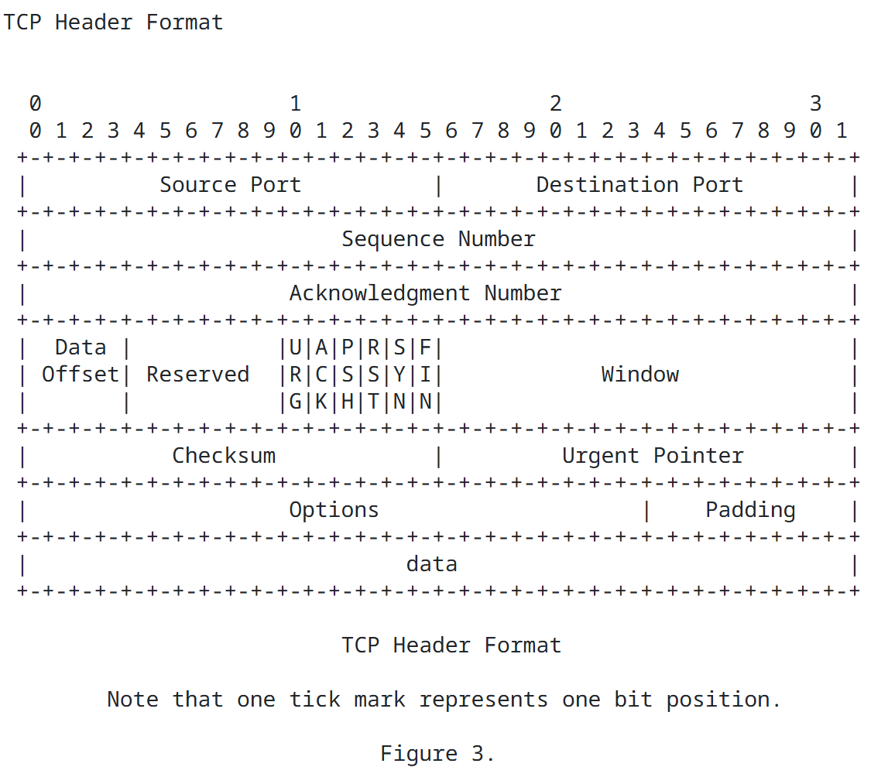

# ft_nmap
## Subject Requirements:


---
# Usage

```
Usage:
	ft_nmap [--help] [--ports [NUMBER/RANGED]] --ip IP_ADDRESS [--speedup [NUMBER]] [--scan [TYPE]]

	ft_nmap [--help] [--ports [NUMBER/RANGED]] --file FILE [--speedup [NUMBER]] [--scan [TYPE]]

Options:
	--file [FILE]
		File containing a list of hosts or IPv4 adress to scan (1 per line).
	--ip [IP_ADDRESS]
		IPv4 adrees to scan. 
	--help
		Print this and exit.
	--ports [NUMBER/RANGED]
		Ports to scan specified as a comma separated list of individual ports or
		ranges (eg: 80,22,1024-2048). The default is 1-1024.
	--speedup [NUMBER]
		Number of parallel threads to use (def: 0, min: 0, max: 250).
	--scan [TYPE]
		Scans to perform specified as a comma separated list. Possible values:
		'SYN/ACK/NULL/FIN/XMAS/UDP' (eg: SYN,UDP). Does them all by default.
Bonus Options:
	--os-detect
		OS detection
	--spoof-ip [IP_ADDRESS]
		Spoof the source IPv4 address. Note: Replies will not return to your host.
	--badsum
		Send packets with an intentional, invalid TCP/UDP checksum.
	--packet-trace
		Display a detailed trace of all raw packets sent and received.
	--ttl [VALUE]
		Set a custom IPv4 Time-to-Live (TTL) field (0-255).
```


# Output Examples

todo

---
# Resources

- [nmap.org](https://nmap.org/)

- [RFC 793](https://datatracker.ietf.org/doc/html/rfc793) -> TCP

The **Transmission Control Protocol** (TCP) is intended for use as a highly reliable **host-to-host protocol** between hosts in **packet-switched** computer communication networks, and in interconnected systems of such networks.

TCP is a connection-oriented, end-to-end reliable protocol designed to fit into a layered hierarchy of protocols which support multi-network applications. The TCP provides for reliable inter-process communication between pairs of processes in host computers attached to distinct but interconnected computer communication networks.Very few assumptions are made as to the reliability of the communication protocols below the TCP layer. TCP assumes it can obtain a simple, potentially unreliable datagram service from the lower level protocols. In principle, the TCP should be able to operate above a
wide spectrum of communication systems ranging from hard-wired connections to packet-switched or circuit-switched networks.

The TCP interfaces on one side to user or application processes and on the other side to a lower level protocol such as Internet Protocol.

## TCP Header Format



Source Port:  16 bits
Destination Port:  16 bits
Sequence Number:  32 bits
Acknowledgment Number:  32 bits
Data Offset:  4 bits
Reserved:  6 bits
Control Bits:  6 bits (from left to right):
    URG:  Urgent Pointer field significant
    ACK:  Acknowledgment field significant
    PSH:  Push Function
    RST:  Reset the connection
    SYN:  Synchronize sequence numbers
    FIN:  No more data from sender

Window:  16 bits
Checksum:  16 bits. The checksum also covers a 96 bit pseudo header conceptually prefixed to the TCP header.
	
Urgent Pointer:  16 bits
Options:  variable
Padding:  variable

---
# Scan Types

| Scan type (Stealth) | Target Port Status | Expected response (Stack Linux) | status |
|--|--|--|--|
|XMAS, NULL, FIN | closed |Packet with the RST flag (RESRET)| **CLOSED** |
|XMAS, NULL, FIN | ? | Complete silence; the timeout is over | **OPEN/FILTERED** |
|XMAS, NULL, FIN **+ SYN** | filtered/firewall | Complete silence; the timeout is over | **FILTERED** |
|XMAS, NULL, FIN **+ SYN** | open | Packet with the SYN-ACK flag (OPEN) | **OPEN** |

---
# AI Usage Disclosure

**Gemini TL:** Custom Gemini Gem acting as a network tutor.

**ChatGPT:** Used as a second opinion and validation tool, particularly to cross-check Gemini's answers, identify possible hallucinations or incorrect assumptions, and provide alternative approaches.

**GitHub Copilot:** Used as a last-resort tool for repository-wide code analysis and debugging when an issue cannot be solved without AI assistance. It is used when the problem requires the AI to inspect multiple files and understand the project as a whole. It is especially useful for tracing problems across different components and their interactions, where providing the full project context manually to other AI tools would be impractical.


