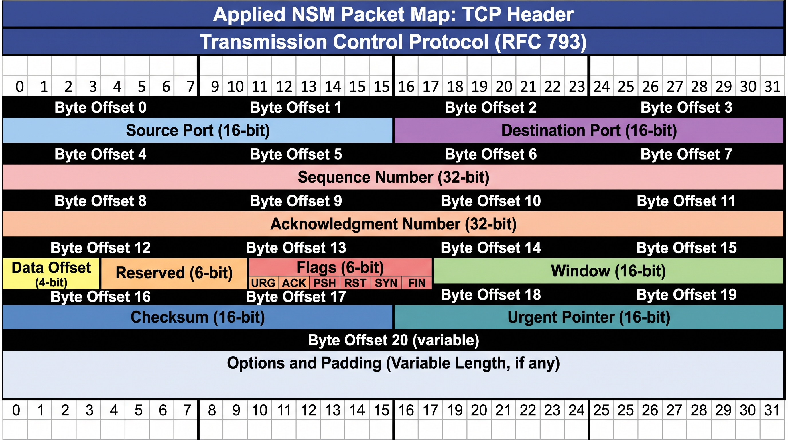
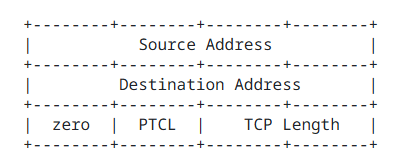
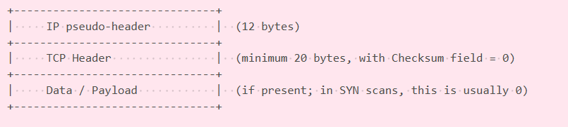

# ft_nmap
## Subject Requirements

### Mandatory Requirements
- **Language & Compilation:**
  - Written in **C** conforming strictly to standard project conventions.
  - A comprehensive `Makefile` must be provided with the standard rules (`all`, `clean`, `fclean`, `re`). It must recompile/re-link objects only when dependencies change.
  - Allowed libraries: standard C library (`libc`), `libpcap` (`-lpcap`), and POSIX threads (`-lpthread`).
  - No crashes, unexpected terminations (Segmentation fault, bus error, double free, unhandled memory leaks), or reliance on calling the official `nmap` binary.
- **Target Specification:**
  - Must accept either a direct IPv4 target via `--ip` or multiple targets via a file list (`--file`).
  - Must support both raw IPv4 addresses (dot notation) and hostnames/FQDN.
- **Port Specification & Limit:**
  - Ports can be provided as single values or ranges (e.g., `80,22,1024-2048`).
  - Defaults to the well-known port range `1-1024` if omitted.
  - The total number of ports scanned per run cannot exceed **1024 ports**.
- **Multi-threading & Performance:**
  - Must support parallel scanning threads via the `--speedup` option (`0` to `250` threads, default is `0`).
- **Scan Types:**
  - Must implement six distinct packet scanning techniques:
    - `SYN` (TCP Stealth / Half-open scan)
    - `NULL` (TCP scan with no flags set)
    - `FIN` (TCP scan with only FIN flag set)
    - `XMAS` (TCP scan with FIN, PSH, and URG flags set)
    - `ACK` (TCP ACK flag scan for firewall rule mapping)
    - `UDP` (Raw UDP packet scan / ICMP port unreachable detection)
  - Scans can be selected individually or combined (comma-separated list). If omitted, all 6 scan types run by default.
- **Output & Resolution:**
  - Must determine the service type associated with scanned ports (e.g., matching standard well-known service names).
  - Clear and structured output format showing scan configuration, elapsed time, port states (`Open`, `Closed`, `Filtered`, `Unfiltered`), and aggregate conclusions.

---

### Bonus Requirements
- **OS Detection (`--os-detect`):** Remote operating system fingerprinting based on network responses.
- **Source IP Spoofing (`--spoof-ip`):** Ability to forge the source IPv4 address in raw IP headers.
- **Checksum Invalidation (`--badsum`):** Generation of invalid TCP/UDP checksums for firewall/IDS evasion testing.
- **Live Packet Tracing (`--packet-trace`):** Detailed verbose log of all raw outbound and incoming frames/packets.
- **Custom TTL Configuration (`--ttl`):** Customization of the IPv4 Time-to-Live field.


---
## Usage

```
Usage:
	ft_nmap [--help] [--ports [NUMBER/RANGED]] --ip IP_ADDRESS [--speedup [NUMBER]] [--scan [TYPE]]

	ft_nmap [--help] [--ports [NUMBER/RANGED]] --file FILE [--speedup [NUMBER]] [--scan [TYPE]]

Options:
	--file [FILE]
		File containing a list of hosts or IPv4 adress to scan (1 per line).
	--ip [IP_ADDRESS]
		IPv4 adrees to scan. 
	--help
		Print this and exit.
	--ports [NUMBER/RANGED]
		Ports to scan specified as a comma separated list of individual ports or
		ranges (eg: 80,22,1024-2048). The default is 1-1024.
	--speedup [NUMBER]
		Number of parallel threads to use (def: 0, min: 0, max: 250).
	--scan [TYPE]
		Scans to perform specified as a comma separated list. Possible values:
		'SYN/ACK/NULL/FIN/XMAS/UDP' (eg: SYN,UDP). Does them all by default.
Bonus Options:
	--os-detect
		OS detection
	--spoof-ip [IP_ADDRESS]
		Spoof the source IPv4 address. Note: Replies will not return to your host.
	--badsum
		Send packets with an intentional, invalid TCP/UDP checksum.
	--packet-trace
		Display a detailed trace of all raw packets sent and received.
	--ttl [VALUE]
		Set a custom IPv4 Time-to-Live (TTL) field (0-255).
```


## Output Examples

todo

---
## Resources

- [nmap.org](https://nmap.org/)

- [RFC 793](https://datatracker.ietf.org/doc/html/rfc793) -> TCP

The **Transmission Control Protocol** (TCP) is intended for use as a highly reliable **host-to-host protocol** between hosts in **packet-switched** computer communication networks, and in interconnected systems of such networks.

TCP is a connection-oriented, end-to-end reliable protocol designed to fit into a layered hierarchy of protocols which support multi-network applications. The TCP provides for reliable inter-process communication between pairs of processes in host computers attached to distinct but interconnected computer communication networks.Very few assumptions are made as to the reliability of the communication protocols below the TCP layer. TCP assumes it can obtain a simple, potentially unreliable datagram service from the lower level protocols. In principle, the TCP should be able to operate above a
wide spectrum of communication systems ranging from hard-wired connections to packet-switched or circuit-switched networks.

The TCP interfaces on one side to user or application processes and on the other side to a lower level protocol such as Internet Protocol.

### TCP Header Format: RFC 793



**Control Bits**:  6 bits (from left to right):

| Flag | Full Name | RFC 793 Purpose | Role in Port Scanning / `nmap` |
|:---:|:---|:---|:---|
| **URG** | Urgent Pointer | Indicates that the *Urgent Pointer* field contains meaningful data requiring immediate processing by the receiving application without waiting in the buffer. | Used in **XMAS scans** along with `FIN` and `PSH` to create an abnormal packet state designed to bypass stateless firewalls and evoke responses from closed ports. |
| **ACK** | Acknowledgment | Confirms receipt of previously transmitted packets. The *Acknowledgment Number* field is only valid when this bit is set. | Sent alone in **ACK scans** to map firewall rules. Open/closed ports return an `RST` without establishing a session, distinguishing between filtered (silent/ICMP error) and unfiltered states. |
| **PSH** | Push Function | Requests that the receiver immediately push all buffered incoming data to the application layer rather than waiting for buffers to fill. | Combined with `FIN` and `URG` in **XMAS scans** to trigger RFC-compliant TCP stack behaviors without initiating a valid connection handshake. |
| **RST** | Reset | Abruptly terminates an existing connection or rejects an invalid/unacceptable incoming segment. | Key diagnostic signal in port scanning. When scanning a closed port (e.g., with `SYN`, `FIN`, `NULL`, `XMAS`), the remote kernel typically responds with an `RST` to signal that no listener exists. |
| **SYN** | Synchronize | Initiates a TCP connection by synchronizing sequence numbers between hosts during the first step of the three-way handshake. | Primary probe for **SYN Stealth scans** (half-open). Receiving a `SYN/ACK` denotes an **OPEN** port, an `RST` denotes a **CLOSED** port, and no response implies **FILTERED**. |
| **FIN** | Finish | Signals that the sender has finished transmitting data and requests to gracefully initiate connection teardown. | Used alone in **FIN scans** or paired in **XMAS scans**. RFC 793 specifies that receiving a `FIN` on a closed port must trigger an `RST`, while an open port must silently discard it. |

**Checksum**:  16 bits. The checksum also covers a 96 bit pseudo header conceptually prefixed to the TCP header.


To calculate the checksum, you must concatenate the following data blocks vertically into a single continuous buffer:



**Options** & **Padding** (0 to 320 bits / 0 to 40 bytes): Additional options (MSS, timestamps, window scale, etc.), padded with zeros to a multiple of 32 bits.


---
## Scan Types

| Scan type (Stealth) | Target Port Status | Expected response (Stack Linux) | status |
|--|--|--|--|
|XMAS, NULL, FIN | closed |Packet with the RST flag (RESRET)| **CLOSED** |
|XMAS, NULL, FIN | ? | Complete silence; the timeout is over | **OPEN/FILTERED** |
|XMAS, NULL, FIN **+ SYN** | filtered/firewall | Complete silence; the timeout is over | **FILTERED** |
|XMAS, NULL, FIN **+ SYN** | open | Packet with the SYN-ACK flag (OPEN) | **OPEN** |

---

## Tests:
todo


---
## Code Quality & Static Analysis Compliance
All C source code strictly adheres to an uncompromising, safety-oriented coding standard inspired by the **Linux Kernel Coding Style** and defensive systems programming guidelines:
- **Modularity & Complexity Limits**: Functions are capped at 25 lines with strict cyclomatic complexity constraints (maximum of 4 parameters and 5 local variables per function).
- **Predictable Control Flow**: Prohibition of global variables, goto statements, and uncontrolled side effects to ensure predictable memory states.
- **Deterministic Resource Management**: Every allocation is audited for immediate null-pointer validation and symmetric deallocation (zero dangling pointers / zero memory leaks).
- **Automated Style & Linter Enforcement**: Codebase validated against static style conformance linters prior to compilation with strict warning flags (`-Wall -Wextra -Werror`).

---
## AI Usage Disclosure

**Gemini TL:** Custom Gemini Gem acting as a network tutor.

**ChatGPT:** Used as a second opinion and validation tool, particularly to cross-check Gemini's answers, identify possible hallucinations or incorrect assumptions, and provide alternative approaches.

**GitHub Copilot:** Used as a last-resort tool for repository-wide code analysis and debugging when an issue cannot be solved without AI assistance. It is used when the problem requires the AI to inspect multiple files and understand the project as a whole. It is especially useful for tracing problems across different components and their interactions, where providing the full project context manually to other AI tools would be impractical.
