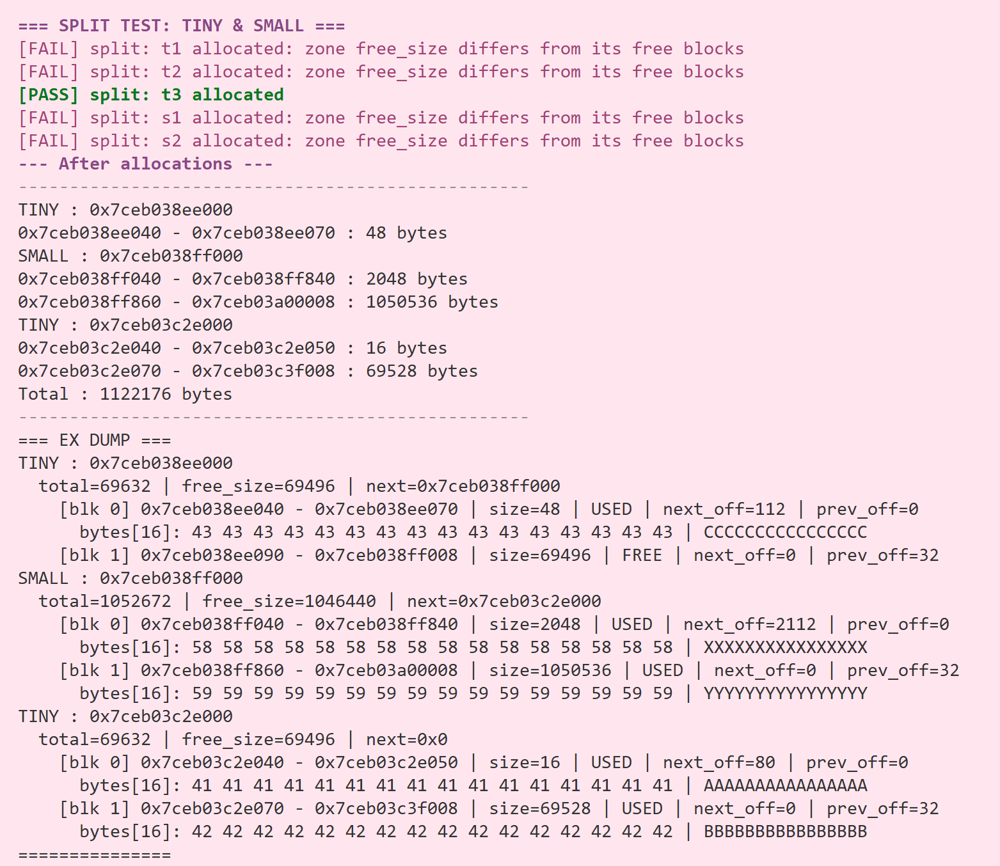
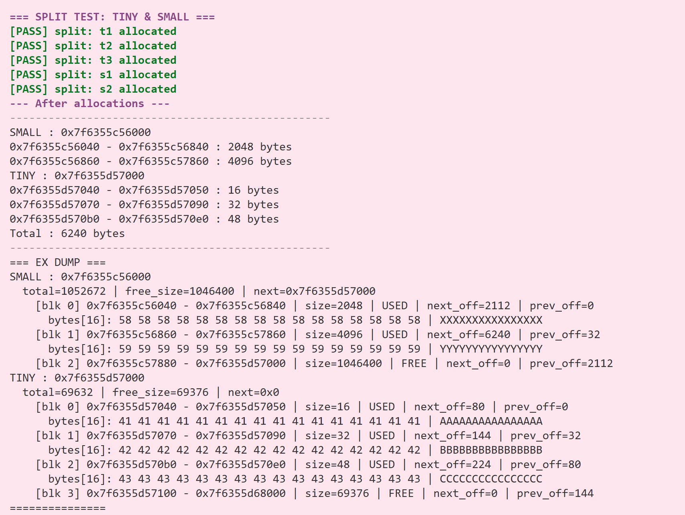

# 42 Malloc

Custom C implementation of dynamic memory allocation (`malloc` and `free`) on Linux using `mmap` and `munmap`, built as a shared library (`libft_malloc.so`) with POSIX mutex thread safety and diagnostic dump helpers.

It exposes the following methods:

```c
//mandatory part
void	*malloc(size_t size);
void	free(void *ptr);

// Debug calls
void	show_alloc_mem();
void	show_alloc_mem_ex();
```

## ⇛ Subject

The goal of this project is to implement a custom dynamic memory allocation mechanism in C that replicates the behavior of standard `libc` functions without modifying or recompiling existing system binaries.

### Core Requirements & Constraints

- **Shared Library & Symlink:** The Makefile must compile a dynamic library named `libft_malloc_$HOSTTYPE.so` (defaulting `$HOSTTYPE` to `` `uname -m`_`uname -s` `` if undefined or empty) and create a symbolic link `libft_malloc.so` pointing to it.
- **Global Variables:** Maximum of **1 global variable** allowed to manage memory allocations (plus **1 additional global** if implementing thread-safety).
- **Allowed Functions:** `mmap(2)`, `munmap(2)`, `getpagesize()` (macOS) / `sysconf(_SC_PAGESIZE)` (Linux), `getrlimit(2)`, `libft` functions, and `libpthread` (for bonus). Using the system `malloc` is strictly forbidden.
- **Memory Alignment:** Returned pointers must be properly aligned (16-byte alignment on 64-bit architectures).
- **Error Handling:** Functions must handle errors safely and never trigger undefined behavior or segmentation faults (`malloc` return `NULL` on failure; `free(NULL)` performs no operation).

### Thread Safety


Public allocation and diagnostic entry points synchronize access to allocator metadata using a POSIX mutex (`src/mutex.c`). Diagnostic functions capture a consistent heap snapshot under the lock and format/write the output after releasing it, keeping the critical section short and avoiding reentrant I/O while locked. Build and test targets link with `-pthread`.

### Zone Architecture

To minimize `mmap()` and `munmap()` system calls, memory is divided into three pre-allocated strategies:

- **TINY** (`1` to `1024` bytes): Served from pre-allocated `TINY` zones.
- **SMALL** (`1025` to `16384` bytes): Served from pre-allocated `SMALL` zones.
- **LARGE** (`> 16384` bytes): Mapped individually via `mmap()` and released directly via `munmap()` on `free()`.

> **Sizing Rules:** Zone sizes `N` and `M` must be multiples of the system page size (`sysconf(_SC_PAGESIZE)`), and each pre-allocated zone must hold at least 64 allocations (including internal metadata headers).

### Project Structure

- `inc/` — Public allocator headers, zone/block definitions, and alignment macros.
- `libft/` — Selected utility functions used by the allocator and test suite.
- `src/` — Core `malloc.c`, `free.c`, `mutex.c`, `show_alloc_mem.c`, and `show_alloc_mem_ex.c`, organized with `utils_heap/`, `utils_malloc/`, and `utils_show_alloc/`.
- `test/` — Test suite (`basic`, `split`, `extreme`, concurrency checks), `strace` runners, and Valgrind logs.


### Visualization

main() example:

```C
int main ()
{
	//TINY
	int *tiny_val;
	*tiny_val = 42;
	//SMALL
	unsigned char *small_buf = (unsigned char *)malloc(2048);
	//LARGE
	unsigned char *large_buf = (unsigned char *)malloc(100000);

	show_alloc_mem();
	show_alloc_mem_ex();

	free(tiny_val);
	free(small_buf);
	free(large_buf);

	show_alloc_mem();
	show_alloc_mem_ex();

	return (0);
}
```

#### ↠ `show_alloc_mem()`

Must print the state of currently allocated memory blocks sorted by increasing memory address, followed by the total allocated bytes:

```text
LARGE : 0x78ffd2645000
0x78ffd2645040 - 0x78ffd265d6e0 : 100000 bytes
SMALL : 0x78ffd265e000
0x78ffd265e040 - 0x78ffd265e840 : 2048 bytes
TINY : 0x78ffd275f000
0x78ffd275f040 - 0x78ffd275f050 : 16 bytes
Total : 102064 bytes
```

#### ↠ `show_alloc_mem_ex()`

```text
=== EX DUMP ===
LARGE : 0x78ffd2645000
  total=102400 | free_size=0 | next=0x78ffd265e000
    [blk 0] 0x78ffd2645040 - 0x78ffd265d6e0 | size=100000 | USED | next_off=0 | prev_off=0
      bytes[16]: 00 00 00 00 00 00 00 00 00 00 00 00 00 00 00 00 | ................
SMALL : 0x78ffd265e000
  total=1052672 | free_size=1050528 | next=0x78ffd275f000
    [blk 0] 0x78ffd265e040 - 0x78ffd265e840 | size=2048 | USED | next_off=2112 | prev_off=0
      bytes[16]: 00 00 00 00 00 00 00 00 00 00 00 00 00 00 00 00 | ................
    [blk 1] 0x78ffd265e860 - 0x78ffd275f000 | size=1050528 | FREE | next_off=0 | prev_off=32
TINY : 0x78ffd275f000
  total=69632 | free_size=69520 | next=0x0
    [blk 0] 0x78ffd275f040 - 0x78ffd275f050 | size=16 | USED | next_off=80 | prev_off=0
      bytes[16]: 2a 00 00 00 00 00 00 00 00 00 00 00 00 00 00 00 | *...............
    [blk 1] 0x78ffd275f070 - 0x78ffd2770000 | size=69520 | FREE | next_off=0 | prev_off=32
===============
```

#### ↠ after `free()`
```text
--------------------------------------------------
SMALL : 0x78ffd265e000
TINY : 0x78ffd275f000
Total : 0 bytes
--------------------------------------------------
=== EX DUMP ===
SMALL : 0x78ffd265e000
  total=1052672 | free_size=1052576 | next=0x78ffd275f000
    [blk 0] 0x78ffd265e040 - 0x78ffd265e840 | size=2048 | FREE | next_off=2112 | prev_off=0
    [blk 1] 0x78ffd265e860 - 0x78ffd275f000 | size=1050528 | FREE | next_off=0 | prev_off=32
TINY : 0x78ffd275f000
  total=69632 | free_size=69536 | next=0x0
    [blk 0] 0x78ffd275f040 - 0x78ffd275f050 | size=16 | FREE | next_off=80 | prev_off=0
    [blk 1] 0x78ffd275f070 - 0x78ffd2770000 | size=69520 | FREE | next_off=0 | prev_off=32
===============

```
#### Example for FAIL tests:

#### Example for PASS tests:



## ⇛ Commands

### Build

```bash
make
make clean # Clean temporary built files
make fclean # Clean all built files
make re
```

### Format

```bash
make norm # check norma implementation
make format # apply norma format to all files
```


### Testing

```bash
# valgrind
make valgrind
make clean_valgrind

# strace
make test_strace
make clean_strace

# 
make test
```

`make test` checks allocator state, block reuse, alignment, boundary sizes, allocation overlap, and concurrent allocation/free calls. It prints green/red results and returns a failure status when an assertion fails. `make valgrind` runs these checks through `ft_malloc`/`ft_free` so Memcheck tests this allocator rather than replacing the standard `malloc`/`free` symbols.

## ⇛ AI Usage Disclosure
To keep authorship and workflow transparency clear across this project, here is how each AI assistant was used during development:

**Gemini**: Used as a conceptual and systems mentor to guide design decisions, architecture, and debugging workflows without providing implementation code.
**ChatGPT**: Used strictly for drafting and formatting function documentation.
**GitHub Copilot**: Used for test structure, formatting, and test harness layout.
**Kimi AI/Claude**: Not used.
